# ✈️ AERORESILIENCE
### An airline operations & supply-chain data platform that traces disruption from a missing part to a missed connection

**Author:** Yogalakshmi Shanmuga Jothi · **Stack:** Snowflake · SQL · Python · Snowpark · Git

> *"If this part doesn't arrive, what does it affect?"*
> AERORESILIENCE answers that question end to end: from a spare part sitting in the wrong warehouse,
> to a grounded aircraft, to a chain of late flights, to passengers and bags missing their connections.

---

## 1. The business problem

Airlines run on many disconnected systems — flight operations, baggage, maintenance, suppliers,
reservations. A disruption in one spreads into all the others, but the data that would reveal the
chain is fragmented, messy, late and inconsistently formatted. AERORESILIENCE integrates those
sources into one tested data platform so the operations team can see **cause → effect** across the
whole network.

## 2. Headline results (one simulated week, 21–27 Oct 2026)

| Measure | Result |
|---|---|
| Flights scheduled / cancelled | 472 / 2 |
| On-time performance (departure < 15 min late) | **83.8%** |
| Share of delay minutes that were **knock-on (reactionary)** | **49%** — the single biggest cause |
| Passenger journeys / arriving 15+ min late | 81,439 / **27.3%** (far worse than flights' 16% — misconnections amplify delay) |
| Bags / mishandled per 1,000 passengers | 69,370 / **6.6** (Emirates **20.3** vs BA **1.2** — hub-transfer exposure) |
| Aircraft-on-ground hours from safety-critical faults | **23.0** |

**The disruption chain the platform surfaces (Q5–Q7 in `40_analytics.sql`):**
- **EK103 (Mumbai → Dubai)** left **569 minutes late** after a technical fault. Through aircraft rotations
  the delay spread across **8 later flights** over four days, and at the Dubai hub **145 passengers
  misconnected** and **46 bags** were mishandled.
- **FLT-0010:** a main-wheel failure (a *NO-GO* item) grounded **PH-JLV at Manchester**, an outstation
  with no spares. The part was couriered from KLM's Amsterdam store; the aircraft spent **12 hours on the
  ground** and its next flight left **669 minutes late**.

## 3. Architecture

```mermaid
flowchart LR
    subgraph SRC["Source systems (simulated, deliberately messy)"]
        FOS[Flight ops<br/>hourly JSON]
        BRS[Baggage x10 airports<br/>gzip JSON Lines]
        MRO[Maintenance<br/>CDC CSV]
        SUP[Supplier portal<br/>CSV + schema drift]
        INV[Inventory<br/>hourly snapshots]
        RES[Reservations + DCS<br/>CSV, synthetic PII]
        WX[Weather API<br/>JSON array, epoch]
    end
    SRC --> STG[(Snowflake stage<br/>date-partitioned landing zone<br/>+ delivery log)]
    STG -->|COPY INTO + lineage metadata| B[BRONZE<br/>21 tables, as received]
    B -->|dedupe · UTC · CDC latest · key derivation| S[SILVER<br/>21 clean tables<br/>40 tests]
    S -->|star schema| G[GOLD<br/>9 dimensions · 8 facts<br/>25 tests vs ground truth]
    G --> A[Analytics<br/>10 business questions]
```



| Layer | Purpose | Key design decisions |
|---|---|---|
| **Sources** | Python simulator of a realistic airline world (planned fleets, hub-and-spoke network, rotations, weather queues, MEL-driven faults, spare-part ledger, passengers, bags) | Deterministic (seeded) → a known **ground truth**; every corruption recorded in a **manifest** |
| **BRONZE** | Data exactly as received, inside tables | All CSV columns `STRING` (schema-on-read); JSON in `VARIANT`; lineage columns (`_source_file`, `_source_row`, load time); idempotent `COPY INTO` (load metadata); **reconciliation** of every file against the delivery log |
| **SILVER** | Trustworthy, typed, de-duplicated data | `QUALIFY ROW_NUMBER()` de-dup; **semantic** de-dup by payload hash for re-sent messages; local-time detection → `CONVERT_TIMEZONE`; CDC latest-version; `flight_id` derived from number + origin + **local** date |
| **GOLD** | Star schema for business questions | MD5 surrogate keys (stable across rebuilds); degenerate `flight_id`; SCD2-ready aircraft dimension; all three fact types — **transaction** (scans, delays), **periodic snapshot** (hourly inventory), **accumulating snapshot** (bag & passenger journeys) |

## 4. Incidents designed in — and handled

| Incident | What the source did | How the platform handles it | Proof |
|---|---|---|---|
| **A** – outage + backfill | One hour of flight messages lost, re-sent next morning | Full rebuild from BRONZE absorbs the late file | Flight events reconcile: 1,253 raw → 1,223 unique |
| **B** – schema drift | Supplier renamed `part_number` → `component_id`, added `carrier_name` | Name-based loading + **schema evolution**; daily header-drift check | [Incident report](docs/incidents/INC-B_supplier_schema_change.md) |
| **C** – silent volume collapse | Frankfurt baggage feed sent 2% of scans for a day | Reconciliation passes (the file was honest) — GOLD labels **317 bags `UNKNOWN_NO_FINAL_SCAN`** instead of guessing | Traced to BA/KLM, the airlines serving FRA |
| **D** – duplicates | Scans repeated 2–5×; messages re-sent with new IDs | Key de-dup + semantic (payload-hash) de-dup | 503,206 raw scans → 468,261 |
| **E** – late data | Events delivered 1–2 days late | Rebuild includes them; `received_late` flag | Tested counts match truth |
| **Time-zone trap** | Dubai sends **local** time in a field named `event_time_utc` | No `Z` suffix → treated as airport local time and converted | Trusting the label would put **18,125 bags on aircraft after departure** |
| **Business-key collision** *(found by tests)* | Same flight number twice per origin per local day | Fixed at source; uniqueness test added | 0 ambiguous keys |

## 5. Data quality: tested against ground truth

Because the source data is deterministic and every corruption is recorded, every test has an
**exact expected value**:
- **SILVER — 40 tests:** row counts after de-dup, uniqueness of business keys, all times parseable,
  no impossible bag loads, delay codes reconcile to delay minutes, every booking resolves to a flight.
- **GOLD — 25 tests:** business numbers equal the original truth (on-time %, rebooked passengers,
  late journeys, mishandled bags, AOG hours) and **no orphan keys** between facts and dimensions.

## 6. Repository structure

```
data_generator/
  01_generate_reference_data.py     airports, airlines, planned fleets, routes, MCTs, suppliers, parts
  02_simulate_operations.py         schedule, rotations, delays, weather queues, tail swaps,
                                    faults (MEL), spare-part ledger, shipments, inventory snapshots
  03_generate_passengers_bags.py    bookings, connections, rebooking, bag journeys (JSON Lines)
  04_generate_raw_feeds.py          messy source feeds + delivery log + corruption manifest
sql/
  00_setup.sql                      warehouse, database, schemas, stage, file formats (idempotent)
  10_bronze_load.sql                BRONZE tables, COPY INTO, reconciliation
  11_incident_b_supplier_schema.sql Incident B: detect, assess, fix (schema evolution), prevent
  12_bronze_reset.sql               clean reload (TRUNCATE also clears load metadata)
  20_silver.sql / 21_silver_tests.sql
  30_gold.sql   / 31_gold_tests.sql
  40_analytics.sql                  the 10 business questions
  99_exploration.sql
docs/incidents/INC-B_supplier_schema_change.md
```

## 7. How to run

1. `sql/00_setup.sql` — Run All
2. In Snowflake Workspaces run the Python generators in order: `01` → `02` → `03` → `04`
3. `10_bronze_load.sql` → `11_incident_b_supplier_schema.sql` (Phase 3)
4. `20_silver.sql` → `21_silver_tests.sql` (all PASS)
5. `30_gold.sql` → `31_gold_tests.sql` (all PASS)
6. `40_analytics.sql` — one query at a time

## 8. Known simplifications
- Development scale (one week, 20 aircraft) — volume is a setting.
- Rotations, not a fixed daily timetable; long-haul ignores night curfews.
- No partner-airline rebooking; no overbooking/no-shows; no cross-airline parts pooling.
- Truth files and the corrupted feeds share one stage; a production design would separate them.
- SILVER/GOLD are full rebuilds — simple and late-data-proof, but not cost-efficient at large scale
  (incremental models are on the roadmap).

## 9. What's built beyond V1

| Version | Delivered | Evidence |
|---|---|---|
| V2 – dbt | All SQL migrated to dbt (staging → intermediate → marts); reconciled against V1 (SILVER 18/18, GOLD 13/13 match via HASH_AGG); [N] tests; incremental `int_bag_scans`; SCD2 snapshot `snap_aircraft` | `aeroresilience_dbt/` |
| V2 – Orchestration | Snowflake Tasks DAG (T1 → T2 → T3) with run logging (Airflow replaced after a local Docker/WSL blocker) | `sql/60_orchestration.sql` |
| V3 – Real-time | Streams on live bag events → automated ops alerts | `sql/70_realtime_alerts.sql` |
| V4 – Governance | Role-based access, masking policies on passenger PII, feed-volume anomaly monitoring (Incident C) | `sql/80_governance.sql` |
| V5 – Intelligence | Forecasting + Power BI operations control tower (4 pages) | `sql/90_forecasting.sql`, `powerbi/` |

## 10. Roadmap
Airflow orchestration · GitHub Actions CI/CD (dbt build on every PR) · Terraform · Kafka streaming · live Power BI connection